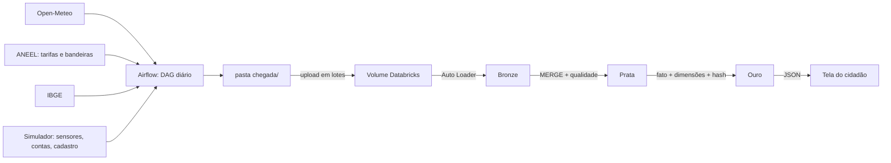

# SeguWatts: componente de Big Data

O SeguWatts mostra ao morador quando e onde a casa gasta energia, quanto isso custa e qual aparelho pode estar com defeito, antes que o problema apareça na conta.

Global Solution 2026.2, FIAP, Engenharia de Software, 4º ano. Disciplina Big Data Architecture & Data Integration.

## Integrantes

| Nome completo | RM |
|---|---|
| Davi Passanha de Sousa Guerra | RM551605 |
| Cauã Gonçalves de Jesus | RM97648 |
| Luan Silveira Macea | RM98290 |
| Rui Amorim Siqueira | RM98436 |
| Luigi Ferrara Sinno | RM98047 |

## Ficha técnica

| Item | Descrição |
|---|---|
| **Produto** | SeguWatts, assistente de uso consciente de energia residencial |
| **Cidadão e território** | Famílias de renda baixa e média no estado de São Paulo |
| **Problema** | O morador só descobre o desperdício quando a conta chega, sem saber a causa |
| **Proposta de valor** | Mostrar onde a energia vai e avisar cedo sobre aparelhos que passaram a gastar mais |
| **Fontes de dados** | Open-Meteo, ANEEL, IBGE e dados simulados de sensores, contas e cadastro |
| **ODS** | 10, 11 e 13 |

## Arquitetura



| Pasta | Conteúdo |
|---|---|
| `dags/` | DAG do Airflow, coleta das fontes e simulador |
| `databricks/` | Notebooks de Bronze, Prata e Ouro, consultas SQL e exportação |
| `amostras/` | Um pouco de cada fonte |
| `mvp/` | Tela do cidadão e o JSON que ela consome |
| `scripts/` | Carga histórica, separação de lotes e validação local |
| `tests/` | Testes de coleta e simulador |
| `docs/` | Contrato com o MVP, roteiro do relatório, design e resultados |

## Por que parte dos dados é simulada

Não existe base aberta de consumo por residência, e dados pessoais reais não podem ser publicados. Por isso, sensores, contas e cadastro vêm de `dags/seguwatts/simulador.py`:

- reproduzível: a mesma semente gera os mesmos dados;
- ligado ao mundo real: geladeira e ar-condicionado reagem à temperatura coletada do Open-Meteo;
- identidades claramente fictícias, como `Morador Exemplo 0001` e `@exemplo.invalid`;
- sujeira proposital, para exercitar as regras de qualidade;
- defeitos injetados e registrados em `chegada/gabarito/falhas.json`, para medir se a detecção funciona.

## Como reproduzir

Requisitos: Python 3.12, Docker e uma conta no Databricks Free Edition.

### 1. Gerar o histórico

```bash
python -m venv .venv
.venv/Scripts/python -m pip install -r requirements.txt
.venv/Scripts/python -m pytest
.venv/Scripts/python scripts/carga_historica.py --inicio 2026-05-01 --fim 2026-10-24
```

### 2. Rodar a coleta no Airflow

```bash
docker compose up -d
```

Acesse `http://localhost:8080`. O usuário é `admin` e a senha aparece com:

```bash
docker compose exec airflow cat /opt/airflow/simple_auth_manager_passwords.json.generated
```

O DAG `seguwatts_coleta` inicia sozinho e processa os dias a partir de 25/10/2026.

**Variables opcionais:** `seguwatts_chegada` (pasta de destino) e `seguwatts_webhook_url` (webhook de notificação). Sem webhook, o aviso vai para o log da tarefa. Nenhuma fonte usada exige chave de API.

### 3. Separar os lotes

```bash
.venv/Scripts/python scripts/montar_lotes.py --nome lote_1 --ate 2026-10-31
.venv/Scripts/python scripts/montar_lotes.py --nome lote_2 --de 2026-11-01
```

### 4. Rodar no Databricks

1. Crie um Git folder com este repositório e rode `databricks/00_setup.sql`.
2. Rode `scripts/compactar_lotes.py lote_1 lote_2` e envie os `.zip` do lote 1 ao Volume `workspace.gs.chegada` pela interface. Os lotes são compactados porque o navegador limita o tamanho do envio.
3. Rode `00b_extrair_lote` com os arquivos do lote 1 e depois `01_bronze`. Anote as contagens.
4. Envie o `.zip` do lote 2, rode `00b_extrair_lote` com ele e rode `01_bronze`. Anote de novo.
5. Rode `01_bronze` mais uma vez sem lote novo: as contagens não mudam.
6. Rode `02_prata`, `03_ouro`, `04_consultas` e `05_exportar_mvp`.

O sal do hash fica no secret `seguwatts/lgpd_sal`, no widget `lgpd_sal` ou, se nenhum existir, em um arquivo gerado no Volume. Ele nunca vai para o repositório.

### 5. Abrir a tela

```bash
.venv/Scripts/python -m http.server 8000 --directory mvp
```

Acesse `http://localhost:8000`. Para usar os dados do Databricks, baixe `mvp/seguwatts_mvp.json` do Volume e coloque em `mvp/dados/`.

### Validar sem Databricks

Roda Prata, Ouro, consultas e exportação com Spark e Delta, usando os mesmos notebooks. Apenas a Bronze é substituída, pois o Auto Loader só existe no Databricks.

```bash
docker run --rm -u root -v "$PWD:/app" -w /app apache/spark:4.0.1-python3 /opt/spark/bin/spark-submit --driver-memory 4g --packages io.delta:delta-spark_2.13:4.0.0 scripts/validar_local.py
```

## LGPD

- A camada Ouro não contém nome, CPF, e-mail, telefone nem o identificador original da residência.
- Titular e residência viram SHA-256 com sal, mantido fora do código.
- E-mail e titular aparecem mascarados, e o CEP fica reduzido a 5 dígitos.
- A tela consome apenas as tabelas `mvp_*`; veja `docs/contrato_mvp.md`.

## Limitações conhecidas

- Sensores, contas e cadastro são simulados, então a qualidade da detecção vale para esses dados.
- O custo não inclui ICMS, PIS e COFINS.
- A referência de cada aparelho são os primeiros 30 dias de uso; um aparelho que já começa com defeito parecerá normal.
- O alerta sugere verificação e não confirma defeito.
